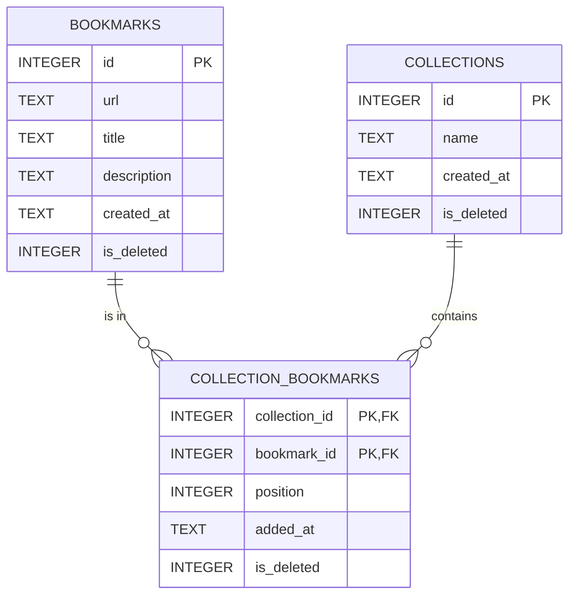

# Database Schema: Bookmarks (Python / Flask)

**Engine:** SQLite
**File:** `DB_PATH` environment variable, defaulting to `bookmarks.db` (relative to the working directory)
**Schema source:** [`schema.sql`](./schema.sql), applied by `init_db()` in [`db.py`](./db.py) on every startup

**Status:** Section 1 describes the schema that exists today. Section 2 is the **proposed design** for the Collections task in `PROBLEM.md`, including soft delete. Nothing in Section 2 has been implemented yet.

---

## 1. Current schema

### `bookmarks`

| Column        | Type    | Null | Default                              | Constraints       | Notes                                                        |
|---------------|---------|------|--------------------------------------|-------------------|--------------------------------------------------------------|
| `id`          | INTEGER | No   | auto (`AUTOINCREMENT`)               | `PRIMARY KEY`     | Used in `/bookmarks/<id>`                                    |
| `url`         | TEXT    | No   | none                                 | `NOT NULL`        | Stored trimmed                                               |
| `title`       | TEXT    | No   | none                                 | `NOT NULL`        | Stored trimmed                                               |
| `description` | TEXT    | No   | `''`                                 | `NOT NULL`        | Optional                                                     |
| `created_at`  | TEXT    | No   | `CURRENT_TIMESTAMP`                  | `NOT NULL`        | UTC, `YYYY-MM-DD HH:MM:SS`. Not changed on update            |

**Indexes:** primary key only. **Foreign keys:** none.

Current access patterns: list all (`ORDER BY id`), get by id, create, update (full replace of url/title/description), delete (hard `DELETE`). Validation lives in `routes.py`, not in the database.

---

## 2. Proposed design: Collections with manual ordering and soft delete

### 2.1 Requirements mapped to schema

| Requirement                                                      | Where it is handled                                                                                  |
|------------------------------------------------------------------|------------------------------------------------------------------------------------------------------|
| Collection CRUD, name required, unique, at least 3 characters    | `collections` table. Unique among active rows via a partial unique index. `CHECK` on length          |
| Soft delete for collections, bookmarks, and memberships          | `is_deleted` on `collections`, `bookmarks`, and `collection_bookmarks`                               |
| Add / remove a bookmark in a collection                          | `collection_bookmarks` rows, with `is_deleted` marking removal                                       |
| A bookmark can be in several collections                         | Many-to-many via `collection_bookmarks`                                                              |
| List bookmarks in a collection, in the user's order              | `collection_bookmarks.position` over active rows, ascending                                          |
| Move a bookmark to a new position in a collection                | Set `position` on the active row                                                                     |
| Existing bookmarks keep working                                  | New column on `bookmarks` defaults to `0`; existing rows stay visible                                |

Ordering belongs to the **membership**, not the bookmark. The same bookmark can be first in "Reading list" and seventh in "Recipes", so `position` lives on the mapping table.

### 2.2 Soft delete convention

- `is_deleted` is `INTEGER NOT NULL DEFAULT 0 CHECK (is_deleted IN (0, 1))`. `0` means active, `1` means deleted. It is on all three tables.
- **Every read filters `is_deleted = 0`.** This applies to lists, gets, updates, and joins. A deleted row is never returned or modified by normal API paths.
- **"Delete" becomes `UPDATE ... SET is_deleted = 1`.** The row stays in place, so foreign keys remain valid and nothing is lost.
- **Uniqueness applies to active rows only.** Otherwise a deleted collection's name could never be reused.
- **No cascades on soft delete.** `ON DELETE CASCADE` only runs on a hard `DELETE`, so the app updates related rows explicitly.

### 2.3 Entity relationship diagram



### 2.4 Changes to the existing table

```sql
-- Adds soft delete to the existing bookmarks table
ALTER TABLE bookmarks ADD COLUMN is_deleted INTEGER NOT NULL DEFAULT 0
    CHECK (is_deleted IN (0, 1));
```

`CREATE TABLE IF NOT EXISTS` in `schema.sql` does **not** add columns to a table that already exists. An existing `bookmarks.db` needs this `ALTER` run once. `collections` and `collection_bookmarks` are new, so they need no migration; they are created with `is_deleted` already in place. See the implementation plan (step 2).

### 2.5 New tables (proposed DDL, not yet applied)

```sql
CREATE TABLE IF NOT EXISTS collections (
    id         INTEGER PRIMARY KEY AUTOINCREMENT,
    name       TEXT NOT NULL CHECK (length(trim(name)) >= 3),
    created_at TEXT NOT NULL DEFAULT CURRENT_TIMESTAMP,
    is_deleted INTEGER NOT NULL DEFAULT 0 CHECK (is_deleted IN (0, 1))
);

-- Name is unique among active collections, case-insensitive.
-- A plain UNIQUE constraint would block reusing the name of a soft-deleted collection.
CREATE UNIQUE INDEX IF NOT EXISTS idx_collections_name_active
    ON collections (name COLLATE NOCASE)
    WHERE is_deleted = 0;

CREATE TABLE IF NOT EXISTS collection_bookmarks (
    collection_id INTEGER NOT NULL REFERENCES collections(id),
    bookmark_id   INTEGER NOT NULL REFERENCES bookmarks(id),
    position      INTEGER NOT NULL CHECK (position > 0),
    added_at      TEXT NOT NULL DEFAULT CURRENT_TIMESTAMP,
    is_deleted    INTEGER NOT NULL DEFAULT 0 CHECK (is_deleted IN (0, 1)),
    PRIMARY KEY (collection_id, bookmark_id)
);

-- Ordered listing of a collection, active rows only
CREATE INDEX IF NOT EXISTS idx_collection_bookmarks_order
    ON collection_bookmarks (collection_id, position)
    WHERE is_deleted = 0;

-- Reverse lookup: "which collections contain this bookmark?"
CREATE INDEX IF NOT EXISTS idx_collection_bookmarks_bookmark
    ON collection_bookmarks (bookmark_id);
```

Note the foreign keys. None of them cascade, because the app never hard deletes:
- A collection or bookmark that is still referenced by a membership cannot be hard deleted. The constraint is a guard against accidental hard deletes.
- Soft deletes are handled explicitly in the app (see 2.6).

#### `collections`

| Column       | Type    | Null | Default            | Notes                                                                                     |
|--------------|---------|------|--------------------|-------------------------------------------------------------------------------------------|
| `id`         | INTEGER | No   | auto               | PK                                                                                        |
| `name`       | TEXT    | No   | none               | At least 3 characters after trimming. Unique among active rows, case-insensitive          |
| `created_at` | TEXT    | No   | `CURRENT_TIMESTAMP`| Same convention as `bookmarks`                                                            |
| `is_deleted` | INTEGER | No   | `0`                | `1` = soft deleted. Hidden from all normal reads                                          |

#### `collection_bookmarks` (mapping, ordering, soft delete)

| Column          | Type    | Null | Default             | Notes                                                                                        |
|-----------------|---------|------|---------------------|----------------------------------------------------------------------------------------------|
| `collection_id` | INTEGER | No   | none                | FK to `collections.id`                                                                       |
| `bookmark_id`   | INTEGER | No   | none                | FK to `bookmarks.id`                                                                         |
| `position`      | INTEGER | No   | none                | Integer greater than 0. Sort key: lowest value shown first. Not required to be contiguous    |
| `added_at`      | TEXT    | No   | `CURRENT_TIMESTAMP` | When the bookmark most recently joined the collection                                        |
| `is_deleted`    | INTEGER | No   | `0`                 | `1` = removed from the collection. Row kept so the membership can be re-added                |

Primary key `(collection_id, bookmark_id)` covers active and deleted rows alike. A bookmark has at most one row per collection, and re-adding it reuses that row (see 2.6).

### 2.6 Operations

| Operation                       | Implementation                                                                                                                                                                                                                                  | Endpoint (suggested)                                                           |
|---------------------------------|-------------------------------------------------------------------------------------------------------------------------------------------------------------------------------------------------------------------------------------------------|--------------------------------------------------------------------------------|
| Create collection               | `INSERT INTO collections (name) VALUES (?)`. Active name clash → `409`                                                                                                                                                                          | `POST /collections`                                                            |
| List collections                | `WHERE is_deleted = 0`                                                                                                                                                                                                                          | `GET /collections`                                                             |
| Get / update collection         | Add `WHERE is_deleted = 0`. Deleted → `404`. Rename must satisfy the length rule and the active-name uniqueness (`409` on clash)                                                                                                                | `GET/PUT /collections/<id>`                                                    |
| Delete collection               | In a transaction. `UPDATE collections SET is_deleted = 1`, then `UPDATE collection_bookmarks SET is_deleted = 1` for all its active memberships. Bookmarks are untouched                                                                        | `DELETE /collections/<id>`                                                     |
| Add bookmark to collection      | In a transaction. Collection and bookmark must both be active (else `404`). If an **active** membership exists → `409`. If a **deleted** membership exists → set `is_deleted = 0`, `position = next`, `added_at = now`. Otherwise insert with `position = next`. `next = COALESCE(MAX(position) over active rows, 0) + 1` | `POST /collections/<id>/bookmarks` with `{"bookmark_id": n}`                   |
| Remove bookmark from collection | `UPDATE ... SET is_deleted = 1` on the active row. Positions of other rows are unchanged                                                                                                                                                       | `DELETE /collections/<id>/bookmarks/<bookmark_id>`                             |
| List bookmarks in collection    | `SELECT b.*, cb.position FROM collection_bookmarks cb JOIN bookmarks b ON b.id = cb.bookmark_id JOIN collections c ON c.id = cb.collection_id WHERE cb.collection_id = ? AND cb.is_deleted = 0 AND b.is_deleted = 0 AND c.is_deleted = 0 ORDER BY cb.position, cb.bookmark_id` | `GET /collections/<id>/bookmarks`                                              |
| Move bookmark to new position   | `UPDATE collection_bookmarks SET position = ? WHERE collection_id = ? AND bookmark_id = ? AND is_deleted = 0`. Validated only as an integer greater than 0. No other rows change                                                                 | `PUT /collections/<id>/bookmarks/<bookmark_id>/position` with `{"position": n}` |
| Create bookmark                 | Unchanged. New rows get `is_deleted = 0` by default                                                                                                                                                                                             | `POST /bookmarks`                                                              |
| Get / list / update bookmark    | Add `WHERE is_deleted = 0` to every query. Deleted bookmarks return `404`                                                                                                                                                                       | `GET /bookmarks`, `GET/PUT /bookmarks/<id>`                                    |
| Delete bookmark                 | In a transaction. `UPDATE bookmarks SET is_deleted = 1`, then `UPDATE collection_bookmarks SET is_deleted = 1` for all its active memberships                                                                                                  | `DELETE /bookmarks/<id>`                                                       |

**No renumbering.** Position is a sort key, not a contiguous index, so removing or deleting a row never requires shifting others. This removes the need for a transaction on move, and the `UNIQUE (collection_id, position)` question goes away as well.

### 2.7 Behavior rules

- **Ordering:** ascending by `position`. Ties are broken by `bookmark_id` so the output is deterministic (see open decision 3).
- **Collection deleted (soft):** the collection and all its active memberships are marked `is_deleted = 1` in one transaction. Its bookmarks are untouched.
- **Bookmark deleted (soft):** the bookmark and all its active memberships are marked `is_deleted = 1` in one transaction. Its collections are untouched.
- **Name reuse:** once a collection is soft deleted, its name is free again. The partial unique index allows a new active collection with the same name.
- **Restore (bookmark or collection):** not in the spec. Recommendation: restoring either one does **not** restore its memberships.
- **Duplicate add (active membership):** `409`.
- **Re-add after removal:** reuses the existing row, so no duplicate primary key occurs.
- **Positions are per collection:** a bookmark has an independent position in each collection it belongs to.
- **Nothing is hard deleted by the app.** Hard deletion stays available only as a manual operation, and the foreign keys block it while memberships reference the row.

### 2.8 Implementation plan

1. **Settle the open decisions in 2.9.**
2. **Migrate the existing database.** `CREATE TABLE IF NOT EXISTS` will not add `is_deleted` to an existing `bookmarks` table. In `init_db()`, run `PRAGMA table_info(bookmarks)` and execute the `ALTER TABLE` from 2.4 only if the column is missing. Then run the new DDL from 2.5. Both steps are idempotent, so each startup is safe.
3. **Update `schema.sql`** so fresh databases get `is_deleted` in the `bookmarks` `CREATE TABLE` as well, plus the new tables and indexes. Keep the migration in `init_db()` for existing databases.
4. **Add a transaction helper in `db.py`** that issues `BEGIN IMMEDIATE`, commits on success and rolls back on error. It is needed for add (re-add or insert), bookmark delete, and collection delete.
5. **Update `models.py`:**
   - Add `is_deleted = 0` filters to every existing bookmark query.
   - Change `delete_bookmark` from `DELETE` to the transactional soft delete in 2.6.
   - Add collection CRUD with soft delete, `add_bookmark_to_collection` (handles re-add and returns `409` on active duplicate), `remove_bookmark_from_collection`, `list_collection_bookmarks`, and `set_position`.
6. **Update `routes.py`** following the existing style: `validate_*` helpers (name length, position is an integer greater than 0), `jsonify(error=...)`, `404` for missing or soft-deleted resources, `409` for conflicts, `201` on create, `204` on delete.
7. **Verify:** exercise the existing bookmark endpoints to confirm no regression, and confirm a soft-deleted bookmark returns `404`. Then test: a bookmark in two collections, reorder with move, remove and re-add, delete a bookmark and check it disappears from every collection, delete a collection and check its bookmarks survive, delete a collection and then create one with the same name, duplicate active name in different case returns `409`, two-character name returns `400`, adding to a soft-deleted collection returns `404`. Run against a throwaway `DB_PATH`.

### 2.9 Open decisions

| # | Question | Recommendation |
|---|----------|----------------|
| 1 | Restore a soft-deleted bookmark or collection: bring back its memberships? | No. Restore only the row itself. |
| 2 | Is there a restore endpoint at all? | Not in the spec. The columns support it, so it can be added later without a schema change. |
| 3 | Two bookmarks with the same `position` in a collection: tie-break? | Order by `bookmark_id`, as in 2.6. Moving to a position already taken places the item next to the other one. If you want true insert-and-shift behavior, the move must rewrite other rows, which brings back the renumbering question. |
| 4 | Record *when* something was deleted (`deleted_at`) as well as *whether*? | Recommended. `deleted_at TEXT NULL` costs little and supports auditing and purge jobs. Not added because it was not requested. |
| 5 | Name validation: trim before storing, or reject names with surrounding spaces? | Trim before storing. Length and uniqueness are then checked on the trimmed value. |
| 6 | Does a collection need a description? | Not in the spec. Add later if needed. |

---

## 3. Things that may have been missed

1. **The migration is the biggest risk.** `CREATE TABLE IF NOT EXISTS` silently skips an existing `bookmarks` table, so the new column never appears and every query filtering on `is_deleted` fails with `no such column`. The `PRAGMA table_info` check in `init_db()` is required. The new collection tables need no such check.
2. **Every existing query now needs a filter.** `list_bookmarks`, `get_bookmark`, `update_bookmark`, and the delete path all need `is_deleted = 0`. Missing one lets a deleted bookmark reappear or be edited.
3. **Soft delete does not cascade.** The app must mark memberships deleted itself for both bookmarks and collections, or deleted items stay listed.
4. **Name uniqueness must be a partial index.** A plain `UNIQUE` constraint on `name` would still reject a name after its collection is soft deleted. The partial unique index in 2.5 is what makes name reuse work.
5. **Joins must check both sides.** The collection-bookmarks listing must filter `is_deleted = 0` on `collections`, `bookmarks`, and `collection_bookmarks`. Missing the collection check shows bookmarks from a deleted collection.
6. **Hard-deleting a parent now fails.** Because nothing cascades, a hard `DELETE` of a collection or bookmark that has memberships raises a foreign key error. That is intentional, but no code path should hard-delete either table.
7. **Foreign keys depend on a per-connection PRAGMA.** `get_conn()` sets `PRAGMA foreign_keys = ON`. Without it, the foreign keys are not checked at all. Any new connection path (scripts, tests) must also set it.
8. **Position is a sort key, not an index.** Gaps and duplicates are allowed. Clients see only the order, so they must not rely on positions being `1..n`.
9. **Duplicate positions are possible.** Two bookmarks can share a position, and the `bookmark_id` tie-break decides their order. Nothing in the database prevents this, by design.
10. **Case-insensitive uniqueness uses `COLLATE NOCASE`, which only covers ASCII.** `"Reading List"` and `"reading list"` clash, but accented or non-Latin case variants do not. This is fine for an interview project but worth knowing.
11. **The length rule is enforced twice.** The `CHECK` constraint and the API validator must agree on "trimmed, at least 3 characters". The API trims before storing, so the database only sees trimmed names.
12. **Soft-deleted rows accumulate.** Nothing purges them. A `deleted_at` timestamp would help with auditing and purge jobs (open decision 4).
13. **`get_conn()` never closes connections.** Its `with conn:` block only commits. Wrap connections with `contextlib.closing` or a `try/finally`.
14. **The index on `bookmark_id` is required.** SQLite does not index foreign-key columns automatically. Without it, every bookmark delete scans the whole mapping table.
15. **Missing vs. not-in-collection need different 404s.** `DELETE /collections/1/bookmarks/9` should say whether collection 1 exists, bookmark 9 exists, or bookmark 9 is not in collection 1.
16. **No tests exist in the repo.** Verification needs a throwaway database. Set `DB_PATH` to a temp file so tests do not touch `bookmarks.db`.
17. **`init_db()` runs at import time in `app.py`.** Importing the app from a test creates the database file as a side effect.
